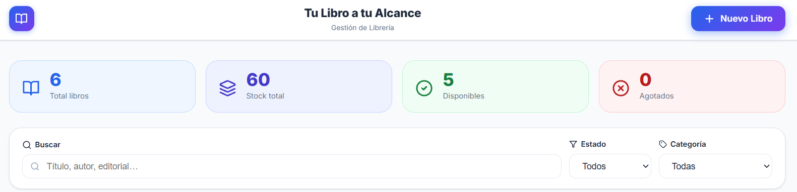
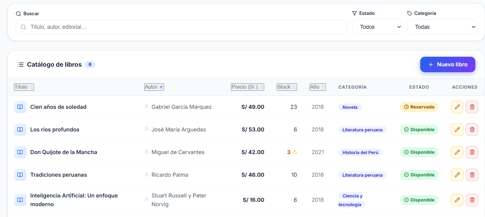

<div align="center">

# Tu Libro a tu Alcance — Sistema CRUD de Librería

**Aplicación web moderna para la gestión de catálogo e inventario desarrollada con PHP (MVC), PDO y MySQL.**

[](https://www.php.net/)
[](https://www.mysql.com/)
[]()
[]()
[](LICENSE)

*Proyecto práctico diseñado para estudiantes de programación y desarrolladores junior que buscan dominar la arquitectura MVC en PHP puro sin depender de frameworks.*

</div>

---

<div align="center">

##  ¿Qué aprenderás con este proyecto?

</div>

- **Patrón Modelo-Vista-Controlador (MVC):** Separación clara entre controladores, modelos, vistas y configuración.
- **Autocarga de clases (`autoload.php`):** Carga dinámica de archivos PHP sin saturar el código con `require` manuales.
- **Seguridad con PDO:** Uso de consultas preparadas (`prepare` / `execute`) para evitar inyecciones SQL.
- **API REST / JSON (`api/libros.php`):** Consumo y respuesta de datos estructurados para operaciones CRUD.

---

<div align="center">

##  Vistas Previas del Sistema

*Las siguientes capturas son ilustrativas y emplean registros ficticios de prueba.*

###  Panel Principal, Métricas y Catálogo


###  Formulario de Registro y Edición


</div>

---

<div align="center">

##  Funcionalidades Clave

</div>

- **Dashboard con Indicadores (KPIs):** Conteo en tiempo real de *Total de libros*, *Stock total*, *Disponibles* y *Agotados*.
- **Búsqueda y Filtrado Multicriterio:** Búsqueda por título, autor o editorial combinada con filtros por **Estado** y **Categoría**.
- **Ordenamiento Dinámico:** Columnas interactivas para ordenar por Título, Autor, Precio, Stock o Año de publicación.
- **Alertas de Inventario:** Indicador visual automático (``) cuando un ejemplar cuenta con pocas unidades disponibles.
- **Gestión Completa (CRUD):** Creación, lectura, edición y eliminación con validación de datos en cliente y servidor.

---

<div align="center">

##  Endpoints de la API (`api/libros.php`)

</div>

| Acción | Método HTTP | Endpoint | Descripción funcional |
| :--- | :---: | :--- | :--- |
| **Listar / Buscar** | `GET` | `/api/libros.php` | Obtiene el listado completo de libros o resultados filtrados. |
| **Registrar libro** | `POST` | `/api/libros.php` | Valida los datos recibidos e inserta un nuevo libro en MySQL. |
| **Actualizar libro** | `PUT` | `/api/libros.php` | Modifica los datos, precio, stock o estado de un libro por su ID. |
| **Eliminar libro** | `DELETE` | `/api/libros.php` | Elimina de forma segura un registro específico de la base de datos. |

---

<div align="center">

##  Estructura del Proyecto

</div>

```text
crud-libros/
├── api/
│   └── libros.php              # Endpoint REST para peticiones JSON (GET, POST, PUT, DELETE)
├── app/
│   ├── Controllers/            # Controladores que coordinan las vistas y acciones
│   ├── Core/                   # Núcleo del enrutador y clases base del patrón MVC
│   ├── Models/                 # Modelos de datos y consultas preparadas PDO
│   ├── Support/                # Clases auxiliares (Config.php, Database.php, helpers.php)
│   ├── Views/                  # Plantillas HTML modularizadas (layout, partials, libros/)
│   └── autoload.php            # Autocargador automático de clases PHP
├── capturas/
│   ├── cap1.png                # Vista del panel principal y catálogo
│   └── cap2.png                # Vista del formulario de registro
├── config/
│   ├── app.php                 # Parámetros generales y rutas base
│   └── database.php            # Credenciales de conexión a MySQL
├── public/
│   └── css/
│       └── app.css             # Hojas de estilo personalizadas y diseño responsivo
├── sql/
│   └── libreria.sql            # Script SQL listo para importar en phpMyAdmin
├── index.php                   # Punto de entrada único (Front Controller)
├── LICENSE                     # Licencia MIT
└── README.md                   # Documentación del proyecto
```

---

<div align="center">

##  Guía de Instalación Rápida

</div>

1. **Descargar o clonar el proyecto:**
   Ubica la carpeta del proyecto dentro del directorio público de tu servidor local (`C:\xampp\htdocs\crud-libros` en XAMPP o `www\crud-libros` en Laragon).
   ```bash
   git clone <URL_DEL_REPOSITORIO>
   ```
2. **Iniciar servicios locales:**
   Abre el panel de control de **XAMPP** (o tu servidor local) e inicia los módulos de **Apache** y **MySQL**.
3. **Importar la base de datos:**
   - Ingresa a `http://localhost/phpmyadmin`.
   - Crea una base de datos nueva (según el nombre configurado en `config/database.php`).
   - Ve a la pestaña **Importar**, selecciona el archivo `sql/libreria.sql` y haz clic en **Importar / Continuar**.
4. **Configurar credenciales (opcional):**
   Si tu usuario o contraseña de MySQL son distintos a los valores por defecto de XAMPP (`root` sin contraseña), ajústalos en `config/database.php`:
   ```php
   return [
       'host'     => '127.0.0.1',
       'database' => 'libreria',
       'username' => 'root',
       'password' => '',
   ];
   ```
5. **Ejecutar el sistema en el navegador:**
   ```text
   http://localhost/crud-libros/
   ```

---

<div align="center">

##  Ideas Breves para Practicar

*Si descargaste este repositorio para estudiar, intenta implementar estas mejoras por tu cuenta:*

</div>

- [ ] **Paginación SQL:** Limitar la tabla a 10 registros por página usando `LIMIT` y `OFFSET`.
- [ ] **Exportación rápida:** Añadir un botón para descargar el catálogo filtrado en formato CSV o Excel.
- [ ] **Control de préstamos:** Agregar una acción rápida que descuente 1 unidad del `Stock` con un clic.
- [ ] **Inicio de sesión:** Proteger el registro y eliminación de libros mediante sesiones en PHP.

---

<div align="center">

##  ¡Apoya este Repositorio!

Si este proyecto te ayudó en tus estudios o te sirvió como base para tus desarrollos:

- **Regálale una estrella (` Star`)** en la esquina superior derecha para que más estudiantes puedan encontrarlo.
- **Haz un `Fork`** si deseas adaptarlo y construir tus propias funcionalidades sobre esta base.
- **Abre un `Issue`** si tienes dudas o sugerencias de mejora.

---

*Distribuido bajo la Licencia MIT.*

</div>
